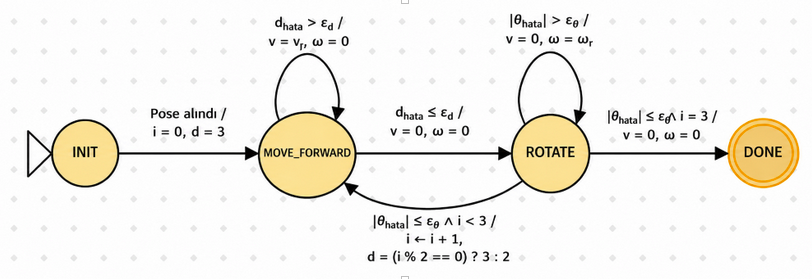

# ROS 2 ile Kapalı Çevrim Dikdörtgen Yörünge Kontrolü

Bu projede, ROS 2 Jazzy ve Python kullanılarak Turtlesim simülasyon ortamında bir robotun **3×2 birimlik dikdörtgen yörüngeyi takip etmesi** sağlanmıştır.

Robotun hareketi, Sonlu Durum Makinesi (Finite State Machine - FSM) ve konum geri beslemesine dayalı kapalı çevrim kontrol (Closed-Loop Control) yaklaşımıyla gerçekleştirilmiştir.

## 1. Projenin Amacı

Projenin amacı, ROS 2'nin Publisher/Subscriber haberleşme yapısını ve asenkron çalışma mekanizmasını kullanarak bir robotun belirlenen yörüngeyi takip etmesini sağlamaktır.

Robot, hareketlerini önceden belirlenmiş sürelere göre değil, `/turtle1/pose` üzerinden aldığı güncel konum ve yönelim bilgilerine göre gerçekleştirir.

Dikdörtgenin kenar uzunlukları:

```python
edges = [3.0, 2.0, 3.0, 2.0]
```

Robot dört kenarı tamamladıktan sonra başlangıç noktasına ve başlangıç yönelimine yaklaşık olarak geri dönerek durur.

## 2. Kullanılan Teknolojiler

| Teknoloji | Açıklama |
|---|---|
| Ubuntu 24.04 | İşletim sistemi |
| ROS 2 Jazzy | Robotik yazılım geliştirme altyapısı |
| Python 3.12 | Programlama dili |
| rclpy | ROS 2 Python istemci kütüphanesi |
| Turtlesim | Robot simülasyon ortamı |
| geometry_msgs | Hız komutları için kullanılan mesaj paketi |

## 3. Sistem Mimarisi

Robotun hareketi iki ROS 2 düğümü arasındaki haberleşmeyle kontrol edilmektedir.

**`/rectangle_turtle`**

Geliştirilen kontrol düğümüdür. Robotun konum bilgisini alır, FSM durumunu değerlendirir ve hız komutlarını oluşturur.

**`/turtlesim`**

Robotun simülasyonunu çalıştıran düğümdür. Hız komutlarını alır ve robotun güncel konumunu yayınlar.

### Kullanılan Topic'ler

| Topic | Mesaj Türü | Görevi |
|---|---|---|
| `/turtle1/pose` | `turtlesim/msg/Pose` | Robotun konum ve yönelim bilgisini yayınlar. |
| `/turtle1/cmd_vel` | `geometry_msgs/msg/Twist` | Robotun doğrusal ve açısal hızlarını kontrol eder. |

Haberleşme yapısı:

```text
       /turtlesim
           |
           | /turtle1/pose
           v
    /rectangle_turtle
           |
           | /turtle1/cmd_vel
           v
       /turtlesim
```

Bu yapı sayesinde robotun hareketleri konum geri beslemesi kullanılarak kontrol edilmektedir.

## 4. Sonlu Durum Makinesi (FSM)

Robotun hareket kontrolü dört durumdan oluşan bir FSM ile gerçekleştirilmiştir.

| Durum | Açıklama |
|---|---|
| INIT | Robotun başlangıç konumu ve yönelimi kaydedilir. |
| MOVE_FORWARD | Robot hedef mesafeye ulaşıncaya kadar ilerler. |
| ROTATE | Robot hedef yönelime ulaşmak için 90° döner. |
| DONE | Dikdörtgen tamamlandığında robot durdurulur. |

### FSM Durum Geçiş Diyagramı



FSM, robotun anlık konum ve yönelim bilgilerine bağlı olarak durumlar arasında geçiş yapmasını sağlar.

`MOVE_FORWARD` durumunda robotun ilerlediği mesafe, `ROTATE` durumunda ise hedef yönelim ile mevcut yönelim arasındaki açı hatası kontrol edilir.

Her iki durumda da hedefe ulaşılıp ulaşılmadığı tolerans değerleri üzerinden değerlendirilir.

Dört kenarın ve son dönüşün tamamlanmasının ardından sistem `DONE` durumuna geçer.

Kontrol işlemleri ROS 2 Timer mekanizmasıyla yaklaşık 20 Hz frekansında gerçekleştirilmektedir.

## 5. Matematiksel Model

### 5.1. Mesafe Hesaplama

Robotun mevcut kenarın başlangıcından itibaren ilerlediği mesafe Öklid uzaklığı kullanılarak hesaplanır.

\[
d=\sqrt{(x-x_{ref})^2+(y-y_{ref})^2}
\]

Burada:

- \(x,y\): Robotun güncel koordinatları
- \(x_{ref},y_{ref}\): Mevcut kenarın başlangıç koordinatları
- \(d\): Kat edilen mesafe

Hedef mesafeye kalan hata:

\[
e_d=L_{hedef}-d
\]

Mesafe hatası belirlenen toleransın içine girdiğinde robot doğrusal hareketini sonlandırarak dönüş durumuna geçer.

### 5.2. Açı Normalizasyonu

Robotun mevcut yönelimi ile hedef yönelimi arasındaki fark şu formülle hesaplanır:

\[
e_\theta=
\operatorname{atan2}
\left(
\sin(\theta_{hedef}-\theta),
\cos(\theta_{hedef}-\theta)
\right)
\]

Bu yöntemle açı farkı \([-\pi,\pi]\) aralığında normalize edilir.

Böylece özellikle \(-\pi\) ve \(+\pi\) sınırlarında oluşabilecek açı taşması problemleri önlenir.

Dönüş, açı hatasının mutlak değeri belirlenen toleransın içine girdiğinde tamamlanır.

## 6. Kurulum

### Gereksinimler

- Ubuntu 24.04
- ROS 2 Jazzy
- Python 3.12
- Turtlesim
- colcon

### Projenin İndirilmesi

ROS 2 çalışma alanının kaynak kod klasörüne geçilir:

```bash
mkdir -p ~/ros2_ws/src
cd ~/ros2_ws/src
```

Proje GitHub üzerinden indirilir:

```bash
git clone https://github.com/EcesuYildirim/ros2-turtlesim-rectangle-controller.git
```

### Paketin Derlenmesi

```bash
cd ~/ros2_ws

source /opt/ros/jazzy/setup.bash

colcon build --packages-select rectangle_controller --symlink-install

source install/setup.bash
```

## 7. Projenin Çalıştırılması

**Terminal 1 — Turtlesim**

```bash
source /opt/ros/jazzy/setup.bash

ros2 run turtlesim turtlesim_node
```

**Terminal 2 — Dikdörtgen Kontrol Düğümü**

```bash
source /opt/ros/jazzy/setup.bash

source ~/ros2_ws/install/setup.bash

ros2 run rectangle_controller rectangle_turtle
```

Program başlatıldığında robot sırasıyla 3, 2, 3 ve 2 birimlik kenarları takip eder.

Her kenarın sonunda 90° sola döner.

Dört kenar ve son dönüş tamamlandığında robotun doğrusal ve açısal hızları sıfırlanır.

## 8. Simülasyon Sonuçları

Turtlesim ortamında gerçekleştirilen ilk testte robotun dikdörtgen yörüngeyi tamamladığı gözlemlenmiştir.

Simülasyon sonunda ölçülen konum ve hız değerleri:

```yaml
x: 5.565420150756836
y: 5.512856960296631
theta: 0.004814700223505497
linear_velocity: 0.0
angular_velocity: 0.0
```

Varsayılan başlangıç konumu yaklaşık `(5.544, 5.544)` kabul edildiğinde, son konum ile başlangıç konumu arasındaki uzaklık yaklaşık **0.038 birim** olarak hesaplanmıştır.

Başlangıç yönelimi sıfır kabul edildiğinde son yönelim hatası yaklaşık **0.28°** olmuştur.

Son durumda doğrusal ve açısal hızların sıfır olduğu doğrulanmıştır.

Bu sonuçlar, temel kapalı çevrim kontrol ve FSM yapısının simülasyon ortamında çalıştığını göstermektedir.

## 9. Gelecek Geliştirmeler

Projenin sonraki sürümlerinde aşağıdaki geliştirmeler planlanmaktadır:

- **P-Kontrolör:** Hedefe yaklaşıldığında doğrusal ve açısal hızların oransal olarak azaltılması.
- **Dinamik Kalem Rengi:** Dikdörtgenin her kenarının farklı renkte çizilmesi.
- **Parametre Yönetimi:** Hızların ve toleransların ROS 2 parametreleriyle değiştirilebilmesi.
- **Birim Testleri:** Mesafe hesabı, açı normalizasyonu ve kontrol fonksiyonlarının test edilmesi.
- **Performans Analizi:** Farklı kontrol yöntemlerinin konum hatası, yönelim hatası ve tamamlanma süresi açısından karşılaştırılması.

## 10. Proje Durumu

**İlk çalışan sürüm tamamlandı.**

Proje, ROS 2 üzerinde Publisher/Subscriber haberleşmesi, Timer tabanlı kontrol ve FSM kullanılarak geliştirilmiştir.

Kontrol hassasiyeti ve yazılım mimarisine yönelik iyileştirmeler sonraki sürümlerde gerçekleştirilecektir.
